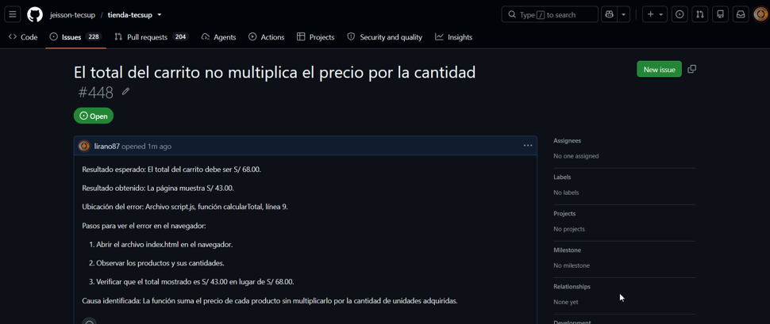

# Guía del Laboratorio 03: Trabajo colaborativo

Esta guía documenta el trabajo realizado en el Laboratorio 03 del curso Diseño Avanzado de Interfaces de Programación.

El objetivo es explicar cómo utilizar Git y GitHub para trabajar de manera colaborativa, gestionar los cambios de un proyecto y compartir contribuciones mediante repositorios remotos.

## Requisitos previos

Para realizar este trabajo colaborativo se necesitan las siguientes herramientas:

### Herramientas utilizadas

- **Git:** permite controlar las versiones del proyecto.
- **GitHub:** permite alojar repositorios remotos y colaborar con otros usuarios.
- **Visual Studio Code:** editor utilizado para trabajar con los archivos del proyecto.
- **Conexión a Internet:** necesaria para comunicarse con GitHub.

## Procedimiento de trabajo colaborativo

Para contribuir en un proyecto mediante Git y GitHub, se pueden seguir estos pasos:

### Pasos para contribuir

1. Realizar un fork del repositorio original en GitHub.
2. Clonar el fork en la computadora utilizando git clone.
3. Crear una rama para trabajar sin modificar directamente main.
4. Realizar los cambios necesarios en los archivos del proyecto.
5. Preparar los cambios con git add y registrarlos mediante git commit.
6. Publicar la rama en GitHub utilizando git push.
7. Crear un Pull Request para proponer los cambios al repositorio original.

## Verificación del trabajo

Las siguientes actividades permiten comprobar el avance del trabajo colaborativo:

- [x] Crear un fork del repositorio original.
- [x] Clonar el repositorio en la computadora.
- [x] Registrar y publicar los cambios en GitHub.
- [x] Crear un Pull Request.
- [ ] Finalizar la documentación de este proyecto.

## Comandos principales de Git

La siguiente tabla describe algunos comandos utilizados durante el trabajo colaborativo.

| Comando | Función |
|---------|---------|
| git clone | Clona un repositorio remoto en la computadora. |
| git add | Prepara los cambios para el próximo commit. |
| git commit | Registra los cambios preparados en el historial local. |
| git push | Envía los commits locales al repositorio remoto. |

## Ejemplo de comandos Git

Para consultar el estado de un repositorio utilizamos `git status`.

Los siguientes comandos muestran un ejemplo de cómo registrar y publicar cambios desde una rama de trabajo:

```bash
git checkout -b mejora-documentacion
git add .
git commit -m "Actualiza la documentacion"
git push -u origin mejora-documentacion
```

## Documentación de referencia

Para consultar información adicional sobre Git, se recomienda revisar su documentación oficial.

- [Documentación oficial de Git](https://git-scm.com/doc)

## Evidencia del trabajo realizado

La siguiente captura muestra una evidencia del trabajo desarrollado durante el Laboratorio 03.



